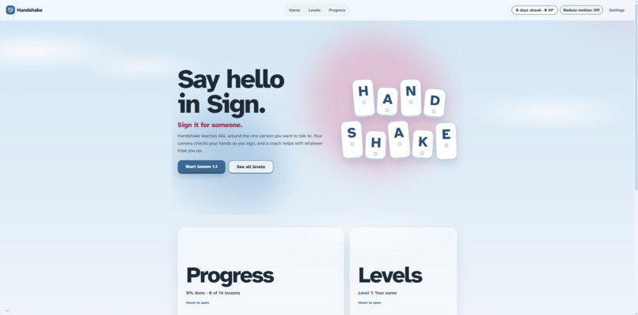
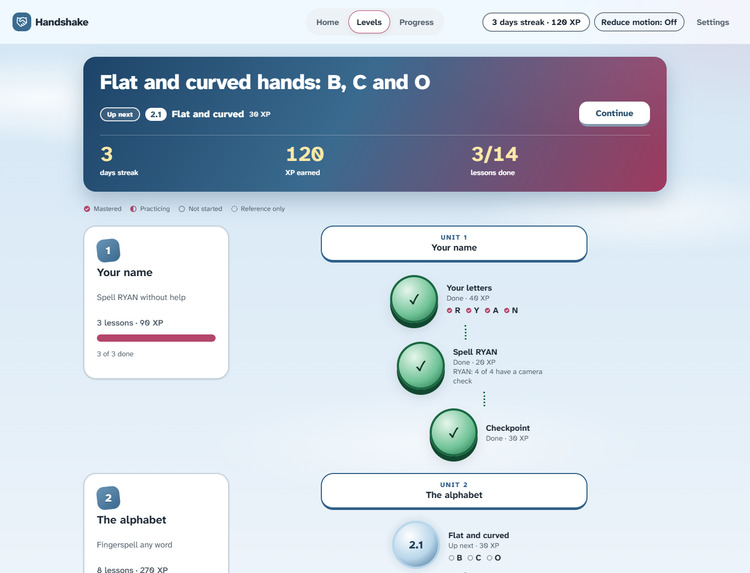
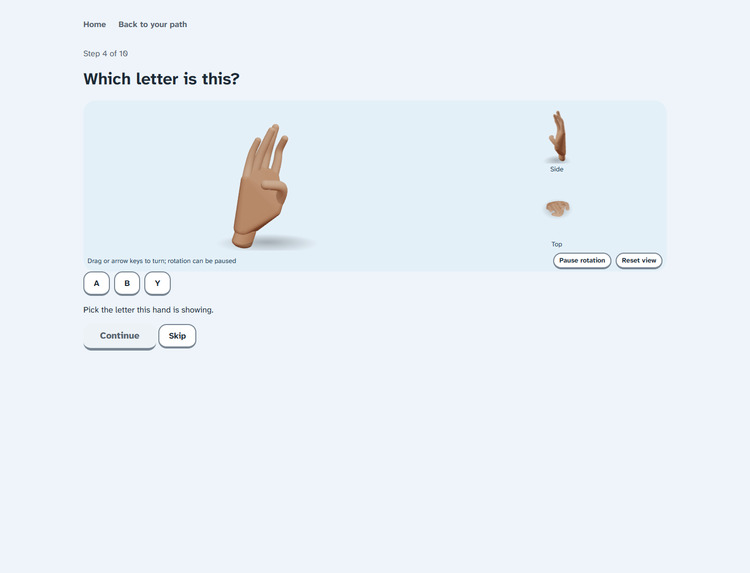
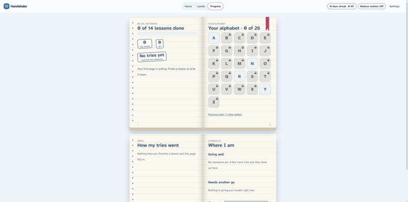
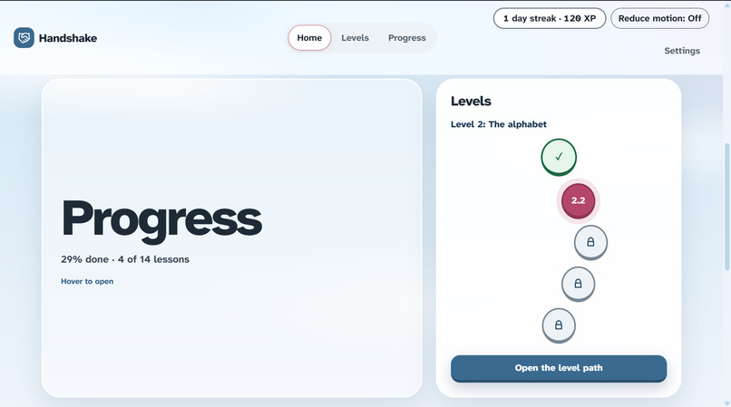
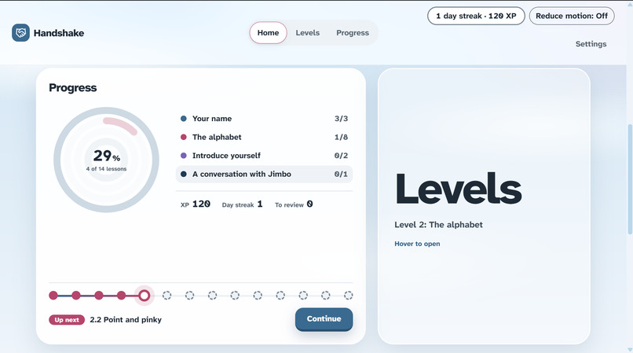
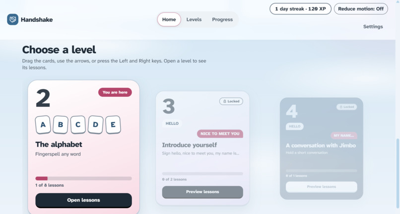
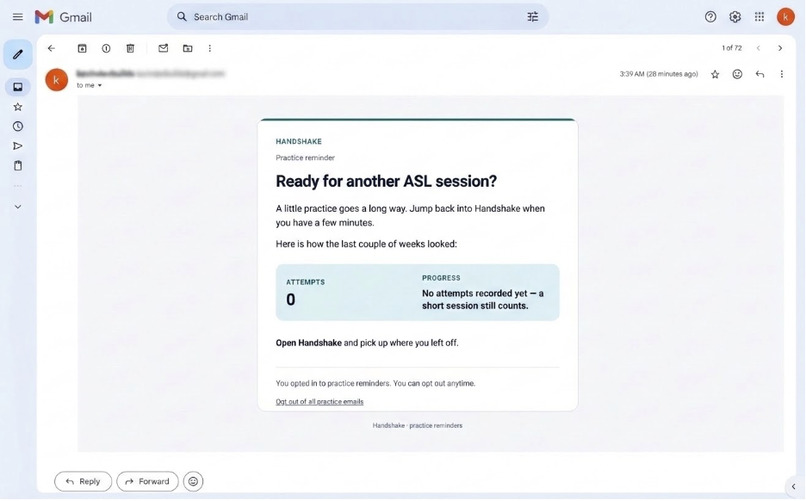

# Handshake

**Bridging the gap between the deaf and hearing, one handshake at a time.**

> 🏆 **Winner of Best Community Impact and the MLH Best Use of Vultr Track at HackCamp 2026.**

**[Watch the demo video](media/demo/handshake-demo.mp4)** · **[Devpost submission](https://devpost.com/software/handshake-6uclst)**



Handshake is a browser-based American Sign Language (ASL) fingerspelling app built around the person you want to talk to. You enter your name, their name, and your signing hand, and it builds a lesson path: your name first, then the alphabet, then spelling *their* name, then a few assisted greetings and a scripted first-hello scene. Your webcam checks your handshapes live, and an AI coach explains what to fix.

## Why we built it

Deaf and hard of hearing people live in a world where almost nobody around them signs. Most hearing people never learn any sign language: classes take time and money, and apps give instructions without any feedback on whether you are actually making the sign correctly. Without even a basic shared language, deaf people are always the ones adapting.

The film *A Silent Voice* shaped our idea. A boy who bullied a deaf girl spends years learning sign language to make things right, and learning her language is how he shows he sees her. Their friendship restarts with a simple handshake. We wanted to make that first step of reaching out more accessible.

Our target user is a hearing person with a Deaf friend, relative, or coworker. How well Handshake fits deaf and hard of hearing learners themselves is still to be confirmed with them.

## Features

### A path built around a person

- Start with the letters in your own name, then work through the alphabet by handshape family, then spell the name of the person you are learning for. Learning for yourself? Skip the second name and that lesson drops out of the path.
- Everyone follows the same unit order and unlock rule, so there is no placement quiz. Only practice words and review adapt to you.
- Start as a guest; no account is needed.



### Live webcam checking

- MediaPipe finds 21 landmarks per hand in your browser, and a recognizer compares your handshape with recorded references.
- Feedback names the finger that is off: curl, direction, or placement.
- If it reads your hand as a look-alike (for example S when you are signing A), it tells you so live.
- A pose must be held briefly before it counts, which cuts down unstable detections.

### Interactive 3D references

- Drag a 3D hand to spin it, or view it from the side and top.
- References are built from the average of recorded MediaPipe world landmarks, so they show real signing.



### AI coaching with Gemini

- Gemini turns measured hand feedback into a short practice cue. If you keep missing, you get a different explanation.
- Practice words are built only from letters you have learned, with extra focus on the ones you struggle with.
- Gemini never decides whether a sign passes, and it never sees names or video. When it is unavailable, canned fallbacks are labelled "cached".

### Short, mixed lessons

- Each new letter is signed once, then practised in a mix: a camera-free "Which letter is this?" exercise, then signing the letters again from memory in random order.
- Some steps hide the reference on purpose. Hint and Show answer reveal more when you are stuck, and neither changes whether a sign matches.

### Progress and reminders

- Lessons, XP, streaks, and practice history are saved as you match, and completed lessons turn green on your path.
- The progress page shows your practice and match rates over the last 14 days.
- Optionally get weekly recap emails, or invite the person you are learning for to receive lesson updates. Every recipient confirms by email first, and every message has an unsubscribe link.



## Screenshots

| | |
| --- | --- |
|  |  |
|  |  |

## How it works

**MediaPipe measures your hands; Gemini coaches you.**

1. **Detect.** MediaPipe returns 21 hand landmarks per frame, and a One Euro filter smooths them.
2. **Describe.** The landmarks become 88 features: normalized coordinates, finger curl, direction, and fingertip distances.
3. **Classify.** A TensorFlow.js MLP (trained offline with scikit-learn) classifies the handshape, or a nearest-neighbour fallback over recorded templates when no model is present. A majority vote over recent frames and a held pose produce one detection.
4. **Coach.** Landmark feedback is the truth. Gemini only rewords it into a cue and never contradicts it.

For two-handed signs such as NAME, NICE, and MEET, MediaPipe's left/right labels flip when the hands overlap, so the app assigns the dominant and other hand by on-screen position and describes the second hand relative to the first, in hand-widths.

## Tech stack

| Layer | Technology |
| --- | --- |
| Frontend | React, TypeScript, Vite, Tailwind |
| 3D references | Three.js, React Three Fiber |
| Hand tracking | MediaPipe Hand Landmarker (in the browser) |
| Recognition | TensorFlow.js MLP, with a recorded-template fallback |
| Model training | Python, scikit-learn, Databricks (MLflow) |
| Backend | Node.js, Express |
| AI coaching | Gemini API |
| Database | Tiger Data (TimescaleDB) |
| Notifications | n8n Cloud, Gmail SMTP |
| Practice planner | Agent hosted on Maritime |
| Hosting | Vercel (frontend), Vultr (API) |

## Getting started

```bash
npm run install:all
cp .env.example .env
npm run dev
```

Open **http://localhost:5173**. The API runs on port **8787**.

The app works without API keys, using cached coaching. To enable live Gemini responses, set `GEMINI_API_KEY` in the root `.env` file and keep that key on the backend. Allow camera access when prompted; webcam access works on `localhost`, and a public deployment requires HTTPS.

Optional services (database, planner agent, email notifications) are configured separately; see the [backend](backend/README.md), [planner agent](agent/README.md), and [notification](n8n/README.md) documentation.

## Project structure

```text
frontend/   Lessons, interface, hand tracking, and recognition
backend/    API, Gemini coaching, and optional practice storage
training/   Tools for training the handshape model
agent/      Optional practice-planning agent
n8n/        Optional notification workflows
media/      Demo video and screenshots used in this README
```

## Testing

```bash
npm run build      # Build the frontend
npm test           # Frontend, backend, and agent tests
npm run test:n8n   # n8n workflow tests
```

## Limitations

Handshake is a hackathon prototype. Its letter comparisons have not been checked by a fluent signer or independently validated, so a detection means **"matches our recording,"** not verified signing accuracy. The moving letters J and Z are reference-only, and the greetings and first-hello scene are introductory exercises, not an assessment of conversational fluency.

Fingerspelling is only part of ASL. Movement, facial expression, and grammar matter too. Handshake supports early practice alongside learning from Deaf teachers and the Deaf community; it is not a complete ASL course.

## Privacy

Names, profile, progress, and mistake history stay in your browser. Webcam practice processes hand landmarks locally, and coaching uses letter targets and measured feedback, never names or a video stream. Optional integrations can store anonymous practice attempts or send consent-based email notifications; they require separate configuration.

## What's next

- Move from letters to words and conversation, with more scenes and a larger everyday vocabulary.
- Add short reference clips of a real signer for each sign, so learners see how it actually moves.
- Have a fluent signer review the references, and evaluate the app with deaf and hard of hearing learners.
- Explore 3D-modelled full sign expressions and conversations.

## License

Released under the [MIT License](LICENSE).
